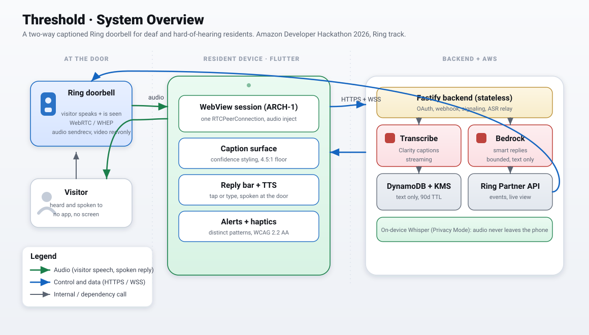
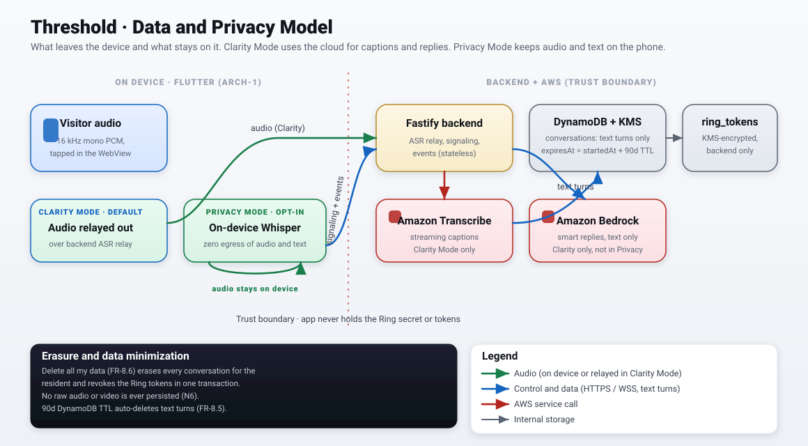
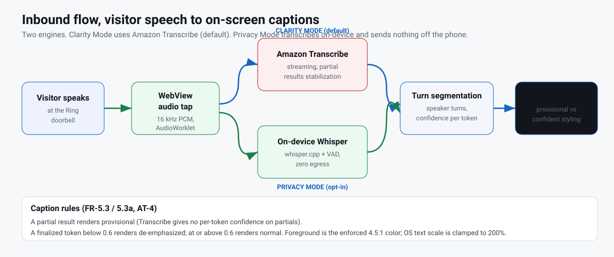
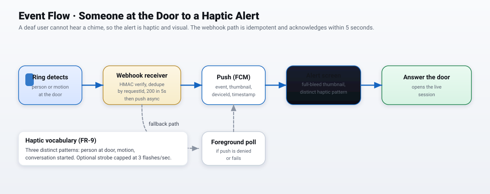

# Threshold backend

Stateless Node 20 + Fastify service for Threshold, the two-way captioned Ring
doorbell. Source of truth for behavior is `.kiro/specs/threshold-doorbell/`.

## Architecture (ports and adapters)



*Where this backend sits: it owns OAuth, webhooks, the signaling broker, the ASR relay, and the AWS calls, and holds the Ring tokens the device never sees.*



*What crosses the trust boundary: text turns and control traffic, never raw audio or video.*



*The ASR relay path this backend owns: Clarity Mode streams audio to Amazon Transcribe, Privacy Mode stays on the device.*



*The idempotent webhook, the push, and the poll fallback that turn a Ring event into an alert.*

Every external dependency is an interface (a port) in `src/services/` with a
real adapter and a fixture adapter. Routes and domain logic depend only on the
port, never on an SDK. This is what lets the whole backend build, test, and demo
with no AWS and no live Ring (NFR-9, design.md §2, §11).

| Port | Interface | Fixture |
|---|---|---|
| Envelope crypto (KMS) | `services/crypto.ts` | `fixtures/local-crypto.ts` (AES-256-GCM) |
| Ring token store | `services/stores.ts` `TokenStorePort` | `fixtures/memory-stores.ts` |
| Event store | `services/stores.ts` `EventStorePort` | `fixtures/memory-stores.ts` |
| Conversation store | `services/stores.ts` `ConversationStorePort` | `fixtures/memory-stores.ts` |
| Ring API | `services/ring.ts` `RingPort` | `fixtures/fixture-ring.ts` |
| Smart Replies (Bedrock) | `services/bedrock.ts` `BedrockPort` | `fixtures/fixture-bedrock.ts` |
| Push (FCM) | `services/push.ts` `PushPort` | `fixtures/fixture-push.ts` |

All Ring parsing is isolated in `services/ring-schema.ts` (FR-17); drift yields a
typed `ring_contract_invalid` rather than a crash.

## Layering

`routes/` (schema-validated I/O) -> `services/` (logic) -> adapters. Routes hold
no business logic; services hold no HTTP concerns.

## Commands

```bash
npm ci          # install pinned deps
npm run dev     # local dev server (fixtures only)
npm test        # vitest unit + contract tests
npm run lint    # eslint
npm run build   # tsc to dist/
```

## Environments

- `local`: fixtures only, no AWS, no real Ring (default).
- `staging`: real AWS, Ring staging users.
- `demo`: deterministic fixtures + cached golden responses.

Copy `.env.example` to `.env` for local dev. In local mode the defaults are
sufficient and no real secrets are needed.
