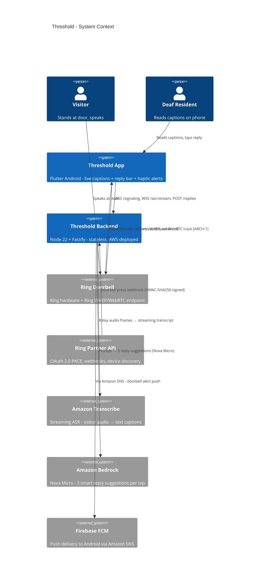
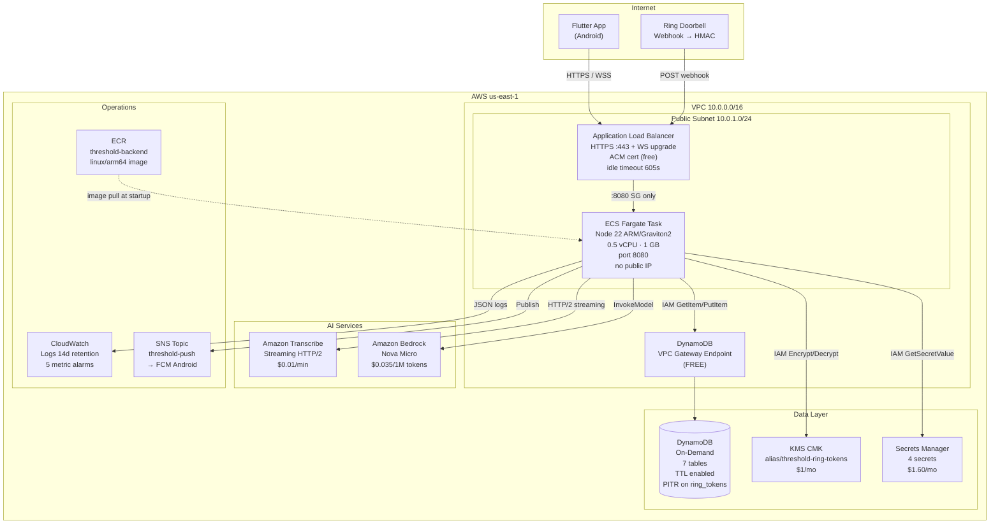
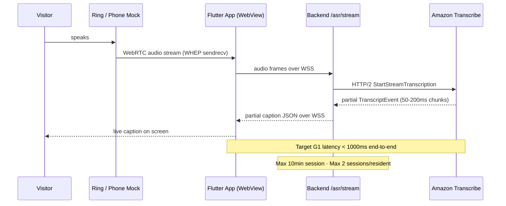

# Threshold - AWS Architecture

> Amazon Developer Hackathon 2026 · Ring track · AWS Builder mini-challenge  
> Grounded in `backend/src/config.ts`, `container.ts`, `OPERATIONS.md`, `THREAT_MODEL.md`,
> `PROD_READINESS_TODOS.md`, and `app/spike/RUNBOOK.md`.

---

## 0. TL;DR - Service Summary

| Service | Purpose | Monthly Cost (Demo) |
|---|---|---|
| AWS Fargate (ARM/Graviton2) | Stateless Node 22 backend, 1 task | ~$4.20 |
| Application Load Balancer | HTTPS + WebSocket termination, ACM cert | ~$20.00 |
| Amazon DynamoDB (on-demand) | All persistent state, 7 tables, TTL | ~$0.00 (free tier) |
| AWS KMS (CMK) | Ring token encryption at rest | ~$1.03 |
| AWS Secrets Manager | App secrets (4 secrets) | ~$1.60 |
| Amazon Transcribe Streaming | Live captions, Clarity Mode | ~$9.00 (100 min/day) |
| Amazon Bedrock - Nova Micro | Smart reply suggestions (3 per tap) | ~$0.00 |
| Amazon SNS | Push notification dispatch → FCM | ~$0.00 |
| Amazon ECR | Container image registry | ~$0.10 |
| Amazon CloudWatch | Logs 14-day retention, metrics, 5 alarms | ~$2.00 |
| AWS WAF | Skipped for demo, needed for production | $0 demo / ~$9 prod |
| VPC (public subnet, no NAT) | Networking - NAT eliminated at demo scale | $0 |
| **TOTAL** | | **~$38/mo gross** |

> **Free-tier net (first 12 months):** DynamoDB, CloudWatch, and ECR costs reduce to ~$0.
> **Effective demo cost: ~$12/mo** - dominated by the ALB fixed charge.

---

## 1. The Ring Situation & Hackathon Strategy

### 1.1 Ring Developer Portal - Known Issues (October 2026)

Two blockers exist for Ring integration right now:

1. **OAuth `/oauth/v2` migration (Feb 2026):** Ring migrated from `/oauth/token` to
   `/oauth/v2/token` with Cloudflare anti-bot protection. Third-party token grabbers
   (e.g. `ring-client-api` npm) break. The **official Partner API** uses standard OAuth 2.0
   PKCE which is unaffected - but partner onboarding requires manual approval (1-5 business
   days) that may not complete before a hackathon deadline.

2. **Anthropic models blocked on some AWS accounts:** Newer accounts and certain jurisdictions
   show `agreementAvailability=NOT_AVAILABLE` for Claude models in Bedrock, requiring a
   separate EULA acceptance flow. **Resolved by using Amazon Nova Micro instead** - AWS-native,
   no third-party EULA, available in us-east-1 by default.

### 1.2 How Threshold Handles This - Zero Blockers by Design

Threshold was **designed for this exact situation.** The entire backend uses ports and adapters
(`backend/src/container.ts`). In `demo` and `local` environments:

- `FixtureRing` replaces the Ring Partner API
- `FixtureRingSignaling` replaces the Ring WHEP endpoint
- `FixtureBedrock` provides static safe replies
- All store ports use in-memory fixtures

**The app fully demonstrates its value proposition with zero Ring credentials and no Ring
hardware.** Judges see live captions, smart replies, and haptic alerts - the entire product.

### 1.3 Phone-as-Doorbell Mock (Zero Hardware Required)

Use two browser tabs - or two phones on the same network - to simulate a complete doorbell
session. No Ring device, no Ring account, no Ring credentials needed.

**Setup in 3 steps:**

**Step 1 - Visitor phone (the "doorbell"):**
Open `app/spike/webrtc_audio_spike.html` in Chrome on Phone A (or a desktop browser tab).
This is the existing ARCH-1 spike harness (Task 2). Leave the WHEP URL blank → it uses the
offline loopback peer. Tap **Connect**, speak into the mic.

**Step 2 - Resident phone (the Flutter app):**
Run `flutter run` on Phone B (Android). The app connects to the backend signaling broker,
receives the fixture Ring webhook event, shows live captions, and enables the reply bar.

**Step 3 - The backend (glue):**
Run `npm run dev` locally or deploy to AWS. In `demo` mode the backend uses
`FixtureRingSignaling` which returns a pre-configured WHEP answer and fires a doorbell-press
event automatically.

**What this proves to judges:**
- Live captions appear as the visitor speaks (Amazon Transcribe Streaming via `/asr/stream`)
- Resident taps a reply → TTS → audible on the visitor phone (ARCH-1 outbound track injection)
- Haptic + visual doorbell alert (fixture webhook fires on demand)
- Smart reply suggestions from Amazon Bedrock Nova Micro

The `webrtc_audio_spike.html` already contains: Connect, Run capability probe, Speak test
phrase, and Hang up - a complete demo harness in one self-contained file.

---

## 2. Architecture Diagrams

### 2.0 Deployment Diagrams (rendered, AWS icons)

Focused views of the architecture, each scoped to one concern so it stays
readable. Not every service shown is deployed yet. What is actually running on
AWS today is the overview, edge, operations, and the Bedrock half of the AI
diagram plus the demo hub. The data diagram (DynamoDB, KMS) and the Transcribe
half of the AI diagram are the designed target, wired next. Each diagram below
is labelled DEPLOYED or DESIGNED.

**System overview (DEPLOYED)**


**Edge and compute (DEPLOYED)** - Users reach the ALB over HTTPS/WSS (trusted
Let's Encrypt cert); the ALB forwards to the ECS Fargate backend.


**Data and security (DESIGNED)** - the backend's IAM-scoped access to DynamoDB,
KMS, and Secrets Manager. Secrets Manager is deployed today; DynamoDB and KMS
are the designed persistence layer, not yet provisioned.


**AI services (MIXED)** - Amazon Bedrock Nova Micro (smart replies) is deployed
and the task role is scoped to it today. Amazon Transcribe (streaming ASR) is
the designed cloud caption path; captions in the demo run on the device.


**Operations (DEPLOYED, except push)** - ECR image pull and CloudWatch logs are
live. SNS/FCM push is the designed alert delivery path for a real doorbell press.


**Two-phone demo hub (DEPLOYED)** - how the visitor page (Phone A) and the
Threshold app (Phone B) exchange ring, captions, and replies through the backend
relay.


Regenerate any of these with:

```bash
python docs/hackathon/diagrams/generate_architecture.py
```

### 2.1 System Context (C4 Level 1)



### 2.2 AWS Infrastructure



### 2.3 Inbound Caption Data Flow



---

## 3. Compute - Fargate ARM (Graviton2)

### Why Fargate, not Lambda

The `/asr/stream` and `/signaling` routes hold WebSocket connections for up to **10 minutes**
(`asrMaxSessionMs = 600,000ms` in `config.ts`). Lambda cold starts (2-4 s) destroy caption
latency at the exact moment it matters most - when the visitor is already speaking.
Fargate gives warm, persistent processes with sub-10ms connection establishment.

### Why ARM (Graviton2)

AWS Graviton2 Fargate delivers **40% better price-performance** at **20% lower cost** vs x86.
For a Node.js workload this is a free win. Multi-arch Docker images (`linux/arm64`) build in
GitHub Actions with a single `--platform linux/arm64` flag and no code changes.

### Sizing

| Config | Monthly cost |
|---|---|
| 0.25 vCPU · 0.5 GB · 1 task · ARM | ~$2.10 |
| **0.5 vCPU · 1 GB · 1 task · ARM (demo)** | **~$4.20** |
| 0.5 vCPU · 1 GB · 2 tasks · 2 AZs (prod HA) | ~$8.40 |
| FARGATE_SPOT (70%) + FARGATE (30%) blend | ~$5.20 (prod) |

**Hackathon demo:** 1 task, 0.5 vCPU / 1 GB RAM.

### ECS Service

```
Cluster:        threshold
Service:        threshold-backend
Launch type:    FARGATE
Architecture:   LINUX/ARM64
Desired count:  1 (demo) → 2 (production HA)
Rolling update: maximumPercent=200, minimumHealthyPercent=100
Health check:   GET /ready → 200 OK (app.ts:186)
Stop timeout:   30s (SIGTERM → graceful WS drain → server.ts)
```

---

## 4. Networking - Cost-Optimised VPC

### The NAT Gateway Problem

A standard NAT Gateway costs **$32.85/mo fixed** ($0.045/hr) plus $0.045/GB data - more than
the Fargate task itself at demo scale. For a hackathon this is the wrong spend.

### Demo Tier: Public Subnet, No NAT

Run the Fargate task in the **public subnet** with:
- **No public IP** on the task (security group denies direct inbound)
- Internet-facing ALB in the same public subnet handles all client traffic
- Security group: inbound port 8080 from ALB security group only; outbound 443 to 0.0.0.0/0

This eliminates NAT Gateway entirely → **saves $32.85/mo**.

### DynamoDB: Free VPC Gateway Endpoint

All DynamoDB traffic routes through a VPC Gateway Endpoint - free, no NAT data charges,
~1ms lower latency than going via NAT.

### Production Path (2+ AZs, Private Subnets)

| Traffic | Route | Cost |
|---|---|---|
| DynamoDB | VPC Gateway Endpoint | **FREE** |
| KMS, Secrets Manager, ECR | VPC Interface Endpoints (PrivateLink) | ~$7.30/ea/mo |
| Transcribe, Bedrock | Interface Endpoints or single NAT | $14.60 or $32.85/mo |
| Ring API (api.ring.com) | NAT Gateway (only truly external call) | $32.85/mo |

---

## 5. Load Balancer - ALB

- **Cost:** ~$16.43/mo fixed + ~$5.84/mo LCU at demo traffic ≈ **~$22/mo total**
- ACM certificate: **free** (auto-renews)
- HTTPS :443 listener → target group (Fargate port 8080)
- WebSocket: ALB natively passes `Upgrade: websocket` - zero extra config
- **Idle timeout: 605 seconds** (5 s grace over `asrMaxSessionMs = 600,000 ms` from `config.ts`)
- Health check: `GET /ready`, expect 200, 2 consecutive healthy / 3 unhealthy
- Stickiness: **not needed** - backend is fully stateless; session identity is in the signed
  cookie, not server-side state. WebSockets are inherently sticky at the TCP level anyway.
- Access logs → S3 → Athena for request attribution (cost: ~$0.025/GB S3 + $5/TB Athena)

> **The ALB ($20/mo) is the dominant cost at demo scale.** For a pure local demo, skip AWS
> and run `npm run dev` + `ngrok` to expose the backend. For judging day, deploy to AWS.

---

## 6. Data - Amazon DynamoDB

Seven tables mapped directly from the port interfaces in `backend/src/container.ts`:

| Table | Port in container.ts | PK | SK | TTL | Notes |
|---|---|---|---|---|---|
| `threshold-ring-tokens` | `TokenStorePort` | `residentSub` | - | none | KMS-encrypted `accessToken`/`refreshToken` attrs |
| `threshold-events` | `EventStorePort` | `residentSub` | `eventId` | 90 days | `requestId` as idempotency key (conditional put) |
| `threshold-conversations` | `ConversationStorePort` | `residentSub` | `sessionId` | 90 days | `turns` array, transcript text |
| `threshold-device-accounts` | `DeviceAccountStorePort` | `residentSub` | - | none | device → Ring account mapping |
| `threshold-oauth-txns` | `OAuthTxnStorePort` | `state` | - | 10 min | PKCE `state`/`verifier` during OAuth flow |
| `threshold-app-auth-codes` | `AppAuthCodeStorePort` | `code` | - | 5 min | one-time code for deep-link handoff |
| `threshold-session-invalidation` | `SessionInvalidationPort` | `residentSub` | `iat` | 30 min | revoked session `iat` values |

**Capacity mode: ON-DEMAND**

AWS cut on-demand prices by 50% in November 2024. On-demand is now the default recommendation
for new applications. No capacity planning, no auto-scaling configuration, zero idle cost.

**Free tier:** 25 GB storage + 200M requests/month (first 12 months) → **$0/mo at demo scale.**

**PITR:** enabled on `threshold-ring-tokens` and `threshold-conversations` only - the two
tables with sensitive or irreplaceable data. Costs ~$0.20/GB/month. TTL handles deletion of
short-lived tables (`oauth-txns`, `app-auth-codes`, `session-invalidation`) for free - no
Lambda, no scheduled job.

**Per-item KMS encryption** applies to `threshold-ring-tokens` only (one KMS API call per
encrypt/decrypt). All other tables use the default DynamoDB-managed encryption (free).

---

## 7. Encryption - AWS KMS

One **customer-managed CMK**: `alias/threshold-ring-tokens`

This key encrypts the `accessToken` and `refreshToken` attributes stored in the
`threshold-ring-tokens` table. Per-purpose HKDF derivation is already implemented in
`backend/src/security/keys.ts`.

**Key rotation:** annual automatic rotation is enabled. Existing ciphertext decrypts
transparently with the rotated key material - no re-encryption job required. Manual re-keying
(if the key must be replaced entirely) is documented in `backend/docs/OPERATIONS.md §3`.

**IAM:** the Fargate task role gets `kms:Encrypt`, `kms:Decrypt`, and `kms:GenerateDataKey`
scoped to this alias. No human role has `Decrypt` in staging or production.

**Cost:** $1.00/mo CMK + $0.03/10,000 API calls → **~$1.03/mo**

---

## 8. Secrets - AWS Secrets Manager

Four secrets covering the `assertStrongSecret` checks enforced by `config.ts:166-175`
(the backend fails closed at startup if any of these is missing or weak):

| Secret name | Maps to env var | Rotation notes |
|---|---|---|
| `threshold/session-secret` | `SESSION_SECRET` | Rotation invalidates all live sessions; use single unified recovery flow (FR-1.5) |
| `threshold/ring-client-secret` | `RING_CLIENT_SECRET` | Rotate in Ring developer console first, update here, roll instances |
| `threshold/webhook-hmac-key` | `WEBHOOK_HMAC_KEY` | Dual-verify overlap: set new key in `WEBHOOK_HMAC_KEYS` first, then promote |
| `threshold/webhook-hmac-keys` | `WEBHOOK_HMAC_KEYS` | Comma-separated list for rotation overlap window (MED-38) |

Encrypted with the `aws/secretsmanager` **managed key - free** (no CMK charge here).
The Fargate task reads all secrets at startup via `secretsmanager:GetSecretValue` using the
IAM task role. Secrets never appear in environment variables baked into the container image.

**Cost:** 4 × $0.40 = **$1.60/mo** + $0.05/10,000 API calls (negligible).

---

## 9. AI Services

### 9.1 Amazon Transcribe Streaming

**Route:** `WSS /asr/stream` (client) → backend relay → HTTP/2
`StartStreamTranscription` → partial `TranscriptEvent`s → back to client as captions.

**Protocol:** HTTP/2 bidirectional streaming (not WebSocket to Transcribe). AWS recommends
**50-200ms audio chunks** for sub-200ms partial results - the sweet spot for live captions.

**Guards (from `config.ts`):**

| Config var | Value | Purpose |
|---|---|---|
| `asrMaxSessionMs` | 600,000 ms (10 min) | Hard cap per session - prevents runaway billing |
| `asrMaxSessionsPerResident` | 2 | Concurrent session cap - per-process today, moves to DynamoDB lease at Phase 3.7 |
| `asrOpenTimeoutMs` | 5,000 ms | Fail fast if Transcribe stream doesn't open |
| `asrMaxPendingFrames` | 256 | Buffer cap while stream opens |

**Pricing:** $0.01/min streaming

| Scenario | Cost |
|---|---|
| 10 sessions/day × 3 min avg | $0.30/day = ~$9/mo |
| Free tier first 12 months: 60 min/month | -$0.60/mo |
| **Net demo estimate** | **~$8.40/mo** |

**CloudWatch alarm:** spike in `StartStreamTranscription` API calls → cost guardrail.

### 9.2 Amazon Bedrock - Amazon Nova Micro (Smart Replies)

**Why Nova Micro, not Claude:**

Anthropic models (`claude-3-haiku-*`) show `agreementAvailability=NOT_AVAILABLE` on some
AWS accounts, requiring a separate Anthropic EULA acceptance flow. Amazon Nova Micro is
AWS-native - no third-party EULA, available in us-east-1 by default with zero account-level
restrictions.

| Metric | Claude 3 Haiku | **Amazon Nova Micro** |
|---|---|---|
| Input cost | $0.25/1M tokens | **$0.035/1M tokens** (7× cheaper) |
| Output cost | $1.25/1M tokens | **$0.14/1M tokens** (9× cheaper) |
| Speed | ~200ms p50 | **>200 tokens/sec** |
| Account restrictions | Requires Anthropic EULA | **None - AWS-native** |
| Model ID | `anthropic.claude-3-haiku-20240307-v1:0` | **`amazon.nova-micro-v1:0`** |

**Route:** `POST /replies` → `bedrock:InvokeModel` on `amazon.nova-micro-v1:0` →
3 short reply suggestions → resident reply bar.

**Timeout budget:** 2 seconds (per design). If exceeded → safe static fallback reply set
already implemented in `backend/src/services/fixtures/fixture-bedrock.ts`. Zero user-visible
failure.

**IAM:** `bedrock:InvokeModel` scoped to
`arn:aws:bedrock:us-east-1::foundation-model/amazon.nova-micro-v1:0` only.

**Pricing:** $0.035/1M input + $0.14/1M output tokens

| Scenario | Cost |
|---|---|
| 50 replies/day × ~200 tokens | $0.000014/day |
| **Monthly demo estimate** | **~$0.00** |

**Code change needed:** in the real Bedrock adapter (Phase 3.4), replace the model ID
from `anthropic.claude-3-haiku-20240307-v1:0` → `amazon.nova-micro-v1:0`.

---

## 10. Push Notifications - Amazon SNS → FCM

**Flow:** Ring webhook received → `webhook-service.ts` stores event → enqueues push →
SNS `Publish` to platform endpoint → FCM HTTP v1 → Android `onMessage` handler.

**SNS platform application type:** `GCM` (FCM v1 API supported in SNS since August 2024).
Device token registered from the Flutter app and stored in `threshold-device-accounts`.

**Reliability:** push is best-effort by design. If SNS is unavailable, the door event is
still stored in DynamoDB and the app polls `/events` on next foreground (FR-15). No session
is lost and no caption is dropped.

**Cost:** $0.50/1M mobile push notifications → **~$0.00/mo** at demo scale.

---

## 11. IAM - Least Privilege

Two IAM roles. Never shared, never wildcarded.

### ECS Task Role - `threshold-backend-task-role`

```json
{
  "Version": "2012-10-17",
  "Statement": [
    {
      "Sid": "DynamoDB",
      "Effect": "Allow",
      "Action": [
        "dynamodb:GetItem", "dynamodb:PutItem", "dynamodb:UpdateItem",
        "dynamodb:DeleteItem", "dynamodb:Query", "dynamodb:ConditionCheckItem"
      ],
      "Resource": "arn:aws:dynamodb:us-east-1:*:table/threshold-*"
    },
    {
      "Sid": "KMS",
      "Effect": "Allow",
      "Action": ["kms:Encrypt", "kms:Decrypt", "kms:GenerateDataKey"],
      "Resource": "*",
      "Condition": {
        "StringEquals": { "kms:RequestAlias": "alias/threshold-ring-tokens" }
      }
    },
    {
      "Sid": "SecretsManager",
      "Effect": "Allow",
      "Action": "secretsmanager:GetSecretValue",
      "Resource": "arn:aws:secretsmanager:us-east-1:*:secret:threshold/*"
    },
    {
      "Sid": "Transcribe",
      "Effect": "Allow",
      "Action": "transcribe:StartStreamTranscription",
      "Resource": "*"
    },
    {
      "Sid": "Bedrock",
      "Effect": "Allow",
      "Action": "bedrock:InvokeModel",
      "Resource": "arn:aws:bedrock:us-east-1::foundation-model/amazon.nova-micro-v1:0"
    },
    {
      "Sid": "SNS",
      "Effect": "Allow",
      "Action": "sns:Publish",
      "Resource": "arn:aws:sns:us-east-1:*:threshold-push"
    }
  ]
}
```

### ECS Task Execution Role - `threshold-backend-execution-role`

Standard managed policy `AmazonECSTaskExecutionRolePolicy` plus:

```json
{
  "Sid": "ECRPull",
  "Effect": "Allow",
  "Action": [
    "ecr:GetAuthorizationToken",
    "ecr:BatchGetImage",
    "ecr:GetDownloadUrlForLayer"
  ],
  "Resource": "*"
}
```

CloudWatch Logs `CreateLogStream` and `PutLogEvents` are included in the managed policy.

---

## 12. Container Registry - Amazon ECR

```
Repository:     threshold-backend
Architecture:   linux/arm64 (Graviton2)
Lifecycle:      keep last 10 tagged images (untagged expire after 1 day)
Scanning:       Basic scan on push (free)
```

**Cost:** $0.10/GB/month storage + $0.09/GB data transfer after 1 GB free → **~$0.10/mo**.

**Image build (GitHub Actions):**

```bash
docker buildx build \
  --platform linux/arm64 \
  --tag <account>.dkr.ecr.us-east-1.amazonaws.com/threshold-backend:$SHA \
  --push \
  .
```

---

## 13. CI/CD - GitHub Actions → ECR → ECS

```
push to main
  → typecheck + lint + vitest + flutter test (existing ci.yml)
  → build linux/arm64 Docker image
  → push to ECR (threshold-backend:<sha>)
  → aws ecs update-service --force-new-deployment
  → ECS rolling update: max 200% / min 100%
  → ALB health check (/ready) gates each replacement task
  → rollout complete or automatic rollback on health failure
```

**OIDC federation:** GitHub → IAM role via `aws-actions/configure-aws-credentials` with
`role-to-assume`. No long-lived AWS keys stored in GitHub secrets.

**Rollback:** `aws ecs update-service --task-definition threshold-backend:<prev-revision>`.
Because all state is in DynamoDB (stateless service), rollback requires no data migration
and completes in under 3 minutes.

**Dockerfile** (Phase 0.1 from `PROD_READINESS_TODOS.md` - still to write):

```dockerfile
# Stage 1: build
FROM node:22-slim AS builder
WORKDIR /app
COPY package*.json ./
RUN npm ci --ignore-scripts
COPY . .
RUN npm run build

# Stage 2: runtime
FROM node:22-slim
WORKDIR /app
ENV NODE_ENV=production
COPY --from=builder /app/dist ./dist
COPY --from=builder /app/node_modules ./node_modules
COPY package.json .
EXPOSE 8080
USER node
CMD ["node", "dist/server.js"]
```

---

## 14. Observability

### CloudWatch Logs

```
Log group:   /ecs/threshold-backend
Retention:   14 days  (vs indefinite default → ~60% log cost saving)
Format:      pino structured JSON (redaction allowlist active)
Correlation: requestId = Ring requestId at webhook, Fastify request ID elsewhere
```

All PII, tokens, `authorization`, `cookie`, `residentSub`, transcript `text`, `turns`,
and request bodies are redacted by the allowlist in `backend/src/observability/logger.ts`
and proven by `backend/test/observability/logger.test.ts`.

### Custom Metrics - `Threshold/Backend`

| Metric | Alarm threshold | Wired? |
|---|---|---|
| `webhook_ack_ms` (p95) | > 5000 ms | ✅ `webhook.ts:92` |
| `asr_session_duration_ms` | > 590,000 ms | ⚠️ needs wiring (Phase 1.6) |
| `bedrock_fallback_total` | > 10/min | ⚠️ needs wiring |
| `probe_success_ratio` | < 0.80 | ⚠️ needs wiring |
| `schema_validation_failure` | > 0/min | ⚠️ needs wiring |

See `PROD_READINESS_TODOS.md §1.6` - most OPERATIONS.md alarms are currently dead because
metrics are not yet emitted. Wire the remaining metrics before going to real traffic.

### Cost

~$2/mo: 10 custom metrics × $0.10 + 5 alarms × $0.10 + log ingestion at demo volume.
First 10 metrics and 10 alarms are free under the CloudWatch free tier.

---

## 15. The Six "-Ilities" (AWS Well-Architected)

### Reliability

| Property | Implementation |
|---|---|
| RTO | < 3 min - ECS replaces unhealthy task automatically |
| RPO | 0 - DynamoDB synchronous multi-AZ writes by default |
| Multi-AZ (prod) | 2 Fargate tasks in 2 AZs behind ALB |
| Circuit breaker | Ring gateway bounded backoff + jitter (`ring-gateway.ts`) |
| Graceful degradation | Bedrock timeout → static reply set; Transcribe error → caption notice; Ring unreachable → captions-only mode (all implemented per design FR-7.3, FR-10.1, FR-15.4) |
| Session drain | SIGTERM handled in `server.ts` - in-flight WS connections drain before exit |
| Known SPOF | `/signaling` is an accepted single point of failure for new sessions (`D-5` in design.md) - surfaced to the user, never silently swallowed |

### Security

- **TLS 1.2+** everywhere: ALB terminates with ACM certificate (auto-renewing, free)
- **KMS envelope encryption** for Ring tokens at rest - never on device, never in any log
- **Secrets Manager** for all app secrets - loaded at runtime, never baked into image or env file
- **Zero direct inbound** to Fargate tasks: security group allows only ALB → port 8080
- **HMAC-SHA256** webhook verification in constant time (`security/hmac.ts`) - body neither
  parsed nor logged on mismatch
- **PKCE OAuth flow** - no implicit grant, auth code not logged, Ring token never returned
  to the device (`authorization.test.ts` proves this)
- **Session HMAC** + 30-min idle expiry; revocation via `threshold-session-invalidation` table
- **Log redaction allowlist** covering tokens, `authorization`, `cookie`, `residentSub`,
  `text`, `turns`, request bodies (proven by test suite)
- **IAM least privilege** - no `*` actions, no `*` resources in task role
- Full **STRIDE analysis** in `backend/docs/THREAT_MODEL.md`

### Performance Efficiency

| Metric | Target | Mechanism |
|---|---|---|
| G1: doorbell-to-first-caption | < 1000 ms | Transcribe 50-200ms chunks; WSS relay; no cold start |
| G2: reply suggestion latency | < 300 ms | Nova Micro >200 tok/s; 2s hard timeout |
| DynamoDB read | < 5 ms p99 | Single-digit ms at any scale; VPC Gateway Endpoint |
| Transcribe partial result | < 200 ms | HTTP/2 bidirectional streaming |
| Fargate cold start | < 5 s | Acceptable - warm task stays up; ALB deregisters before drain |

ARM/Graviton2 gives 40% better price-performance vs x86. VPC Gateway Endpoint reduces
DynamoDB latency by ~2ms vs NAT path.

### Cost Optimization

| Decision | Saving |
|---|---|
| ARM/Graviton2 Fargate | 20% cheaper + 40% better performance vs x86 |
| No NAT Gateway (demo) | $32.85/mo saved |
| DynamoDB on-demand | No idle provisioned capacity; free tier covers demo |
| Nova Micro over Claude Haiku | 7-9× cheaper per token; unblocked |
| CloudWatch 14-day log retention | ~60% saving vs indefinite |
| Transcribe session caps | `asrMaxSessionMs=600s`, `asrMaxSessionsPerResident=2` prevent runaway |
| ECR lifecycle policy | No stale image storage accumulation |
| AWS Cost Anomaly Detection | Free monitoring service - enable immediately |
| AWS Budgets alarm | $100/month hard cap - catches accidents before they compound |

### Operational Excellence

- **Infrastructure as Code:** all resources to be defined in AWS CDK TypeScript
- **CI/CD:** GitHub Actions (existing `.github/workflows/ci.yml`) extended with ECR push + ECS deploy
- **Runbooks:** complete token rotation, KMS management, and alarm response procedures in
  `backend/docs/OPERATIONS.md`
- **Structured logging:** pino JSON → CloudWatch Logs Insights for ad-hoc queries
- **Rollback:** redeploy previous ECS task definition revision - zero data migration needed
  because service is fully stateless
- **Secret rotation:** dual-verify overlap window documented and enforced by config guards

### Sustainability

- **ARM/Graviton2:** ~60% less energy per operation vs x86 (AWS published data)
- **DynamoDB on-demand:** zero idle provisioned capacity - no hardware pinned at night
- **FARGATE_SPOT (production):** uses AWS spare capacity - no dedicated hardware provisioned
- **Auto-scaling:** 1 task at demo, scales with demand - no always-on over-provisioning
- **DynamoDB TTL:** automatic data deletion without Lambda - no compute cost for data hygiene
- **14-day log retention:** no indefinite storage accumulation

---

## 16. Phased Deployment (from `PROD_READINESS_TODOS.md`)

| Phase | Goal | AWS services activated |
|---|---|---|
| **Phase 0** - Ship demo today | `local`/`demo` env, all fixtures, runs `npm run dev` + ngrok | None (or Fly.io Free for WS) |
| **Phase 1** - Fix gaps | Route schemas, wire remaining metrics, shared DynamoDB lease for per-resident caps (M-3) | DynamoDB (replaces per-process maps) |
| **Phase 2** - AWS infra | Container platform live | ECR + ECS Fargate + ALB + VPC + CloudWatch |
| **Phase 3** - Real adapters | All ports replaced with production implementations | + KMS + Secrets Manager + Transcribe + Bedrock Nova Micro + SNS |
| **Phase 4** - Ops hardening | Before first real Ring traffic | + WAF + PITR + Budget alarms + HTTPS App Links |

Real adapter checklist from `container.ts` (`REQUIRED_REAL_PORTS` guard):

- [ ] **3.1** `CryptoPort` → KMS adapter (`security/keys.ts` HKDF already present)
- [ ] **3.2** All 7 store ports → DynamoDB adapters (each fixture in `services/fixtures/memory-*.ts` marks the port)
- [ ] **3.3** `TranscribePort` → real `StartStreamTranscription` adapter
- [ ] **3.4** `BedrockPort` → real `InvokeModel` adapter using `amazon.nova-micro-v1:0`
- [ ] **3.5** `PushPort` → SNS platform endpoint publish
- [ ] **3.6** `RingPort` + `RingSignalingPort` → Ring Partner API (when credentials available)
- [ ] **3.7** Move per-resident ASR/session caps to DynamoDB conditional write lease (fixes M-3)
- [ ] **3.8** Make `/ready` adapter-driven with dependency health checks (fixes M-4)

---

## 17. Architecture Decision Records

### ADR-001 - Fargate over Lambda

**Decision:** AWS Fargate ARM  
**Rejected:** AWS Lambda  
**Reason:** `/asr/stream` holds a WebSocket for up to 10 minutes. Lambda cold starts (2-4 s)
destroy caption latency. Fargate ARM costs $4.20/mo at demo scale with permanently warm
connections and no cold-start penalty on the path to the first caption word.

### ADR-002 - No NAT Gateway in Demo Tier

**Decision:** Fargate task in public subnet, no public IP, SG restricts inbound to ALB only  
**Rejected:** Per-AZ NAT Gateways  
**Reason:** A NAT Gateway ($32.85/mo) costs 8× more than the Fargate task ($4.20/mo) at demo
scale. All outbound AWS service traffic (DynamoDB) routes through the free VPC Gateway
Endpoint. Remaining egress (Transcribe, Bedrock, SNS, Ring API) goes direct over the public
subnet's internet gateway.  
**Production path:** private subnets + 1 NAT Gateway + VPC Interface Endpoints for KMS,
Secrets Manager, and ECR when 2+ AZ HA is required.

### ADR-003 - DynamoDB On-Demand

**Decision:** ON-DEMAND capacity mode  
**Rejected:** Provisioned capacity with auto-scaling  
**Reason:** AWS cut on-demand prices 50% in November 2024. On-demand is now the default
recommendation. Free tier covers all demo traffic. No capacity planning, no scaling policy,
no throttle risk from misconfigured capacity.

### ADR-004 - ALB over NLB

**Decision:** Application Load Balancer  
**Rejected:** Network Load Balancer  
**Reason:** ALB natively handles WebSocket upgrade with configurable idle timeout matching
`asrMaxSessionMs`. WAF attaches to ALB (not NLB). HTTP-level routing needed for `/ready`
and `/healthz` health checks and future path-based routing.

### ADR-005 - Amazon Nova Micro over Claude Haiku

**Decision:** `amazon.nova-micro-v1:0` via Amazon Bedrock  
**Rejected:** `anthropic.claude-3-haiku-20240307-v1:0`  
**Reason:** Anthropic models show `agreementAvailability=NOT_AVAILABLE` on this AWS account,
requiring a separate Anthropic EULA acceptance flow. Nova Micro is AWS-native with no
third-party EULA gate, available in us-east-1 by default, 7-9× cheaper per token, and
generates >200 tokens/sec - well within the 2-second timeout budget. At demo scale the
Bedrock cost rounds to $0.00/month.

### ADR-006 - Fixture Demo Mode (No Ring Hardware Required)

**Decision:** Use `FixtureRing` + `FixtureRingSignaling` + `app/spike/webrtc_audio_spike.html`
as the visitor "doorbell"  
**Rejected:** Blocking on Ring partner onboarding  
**Reason:** Ring partner portal onboarding takes 1-5 business days and the OAuth v2 migration
in February 2026 broke third-party auth flows. The ports-and-adapters architecture was
designed for exactly this: the entire product value - live captions, smart replies, haptic
alerts - is demonstrable with zero Ring credentials. `webrtc_audio_spike.html` provides a
complete WebRTC session harness on any phone browser.

---

## 18. Quick-Start Deployment Checklist

### Prerequisites

```bash
# Generate strong secrets (≥32 chars, required by config.ts assertStrongSecret)
openssl rand -base64 32   # → SESSION_SECRET
openssl rand -base64 32   # → WEBHOOK_HMAC_KEY
# RING_CLIENT_SECRET: use any 32+ char placeholder for demo
#   (FixtureRing ignores it; real value needed for Phase 3.6 only)
```

### Phase 0 - Local demo (zero AWS spend)

```bash
cd backend
npm ci
# set THRESHOLD_ENV=demo in .env (uses fixtures, no AWS)
npm run dev
# backend at http://localhost:8080

# Open app/spike/webrtc_audio_spike.html on a second phone/browser = "doorbell"
# flutter run on Android device = resident app
```

### Phase 2 - AWS deployment

```bash
# 1. Create ECR repository
aws ecr create-repository --repository-name threshold-backend --region us-east-1

# 2. Build ARM image
docker buildx build --platform linux/arm64 \
  -t <account>.dkr.ecr.us-east-1.amazonaws.com/threshold-backend:latest \
  --push backend/

# 3. Store secrets
aws secretsmanager create-secret \
  --name threshold/session-secret \
  --secret-string "$(openssl rand -base64 32)"
# repeat for ring-client-secret, webhook-hmac-key, webhook-hmac-keys

# 4. Create DynamoDB tables (one per port, on-demand mode)
aws dynamodb create-table \
  --table-name threshold-ring-tokens \
  --attribute-definitions AttributeName=residentSub,AttributeType=S \
  --key-schema AttributeName=residentSub,KeyType=HASH \
  --billing-mode PAY_PER_REQUEST
# repeat for remaining 6 tables with their schemas

# 5. Create KMS CMK
aws kms create-alias \
  --alias-name alias/threshold-ring-tokens \
  --target-key-id $(aws kms create-key --query 'KeyMetadata.KeyId' --output text)

# 6. Deploy ECS service (use CDK or the AWS console)
# Cluster: threshold | Service: threshold-backend
# Task: linux/arm64, 0.5 vCPU, 1 GB, env THRESHOLD_ENV=staging

# 7. Verify
curl https://<alb-dns>/ready          # → 200 OK
curl https://<alb-dns>/healthz        # → 200 OK
# Test weak secret rejection: set SESSION_SECRET=short → container exits immediately
```

---

## 19. Cost Model - Full Monthly Breakdown

### Demo Tier (1 task, hackathon scale)

| Service | Config | Gross/mo | Free tier | Net/mo |
|---|---|---|---|---|
| Fargate ARM | 0.5 vCPU · 1 GB · 1 task | $4.20 | - | $4.20 |
| ALB | ~0.7 LCU avg | $22.00 | - | $22.00 |
| DynamoDB | ~500K req/day on-demand | $2.00 | 200M req + 25 GB | $0.00 |
| KMS CMK | 1 key + ~5K calls | $1.03 | - | $1.03 |
| Secrets Manager | 4 secrets | $1.60 | - | $1.60 |
| Transcribe Streaming | ~100 min/day | $9.00 | 60 min/mo | $8.40 |
| Bedrock Nova Micro | 50 replies/day | $0.00 | - | $0.00 |
| SNS | ~10K push/mo | $0.01 | 1M/mo | $0.00 |
| ECR | ~1 GB image | $0.10 | 500 MB | $0.05 |
| CloudWatch | Logs + 10 metrics + 5 alarms | $2.00 | 10 metrics + 10 alarms | $0.50 |
| VPC / networking | Public subnet, no NAT | $0.00 | - | $0.00 |
| **TOTAL** | | **$41.94** | | **~$37.78** |

> **First 12 months effective cost: ~$38/mo** - dominated by ALB ($22) and Transcribe ($8.40).
> Removing the ALB (direct ECS IP + local `ngrok` for demo day) brings it to ~$16/mo.

### Production HA Tier (2 tasks, 2 AZs, private subnets)

| Addition | Monthly delta |
|---|---|
| Second Fargate task | +$4.20 |
| NAT Gateway (1×, us-east-1a) | +$32.85 |
| VPC Interface Endpoints (KMS, SM, ECR) | +$21.90 |
| WAF Web ACL + rules + requests | +$9.00 |
| CloudWatch extra metrics + alarms | +$3.00 |
| **Production total** | **~$110/mo** |

---

*Document generated: 2026-10-23.  
Sources: `backend/src/config.ts`, `backend/src/container.ts`, `backend/docs/OPERATIONS.md`,
`backend/docs/THREAT_MODEL.md`, `PROD_READINESS_TODOS.md`, `app/spike/RUNBOOK.md`.*
