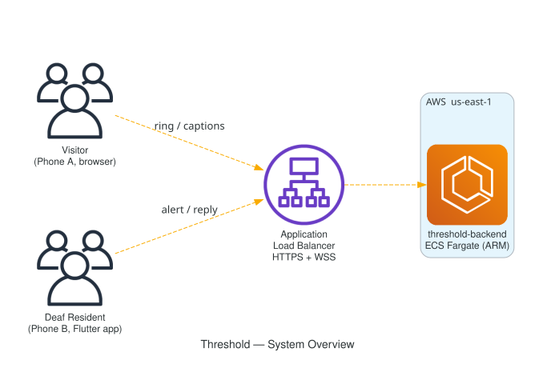
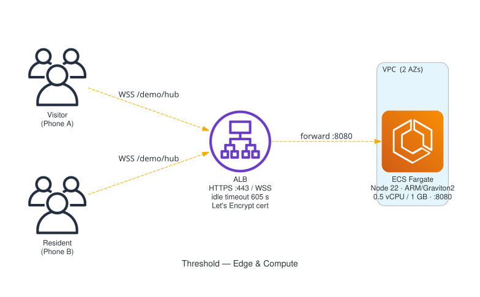
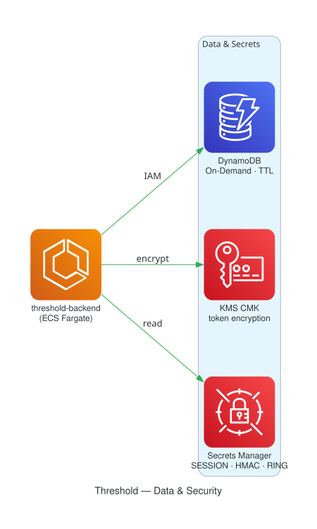
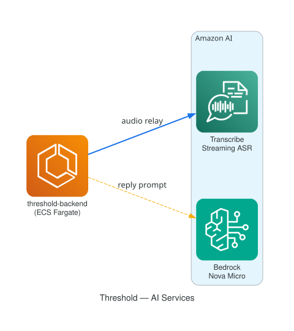
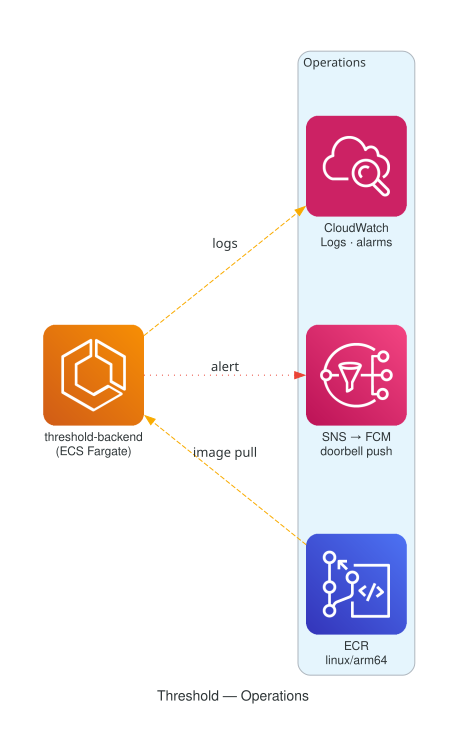
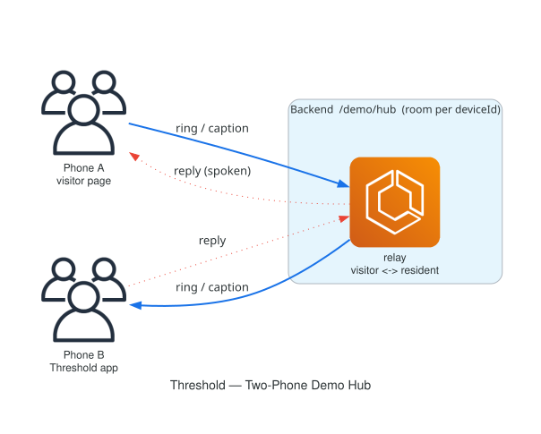

# Threshold Architecture Diagrams

Professional architecture diagrams for Threshold, split into focused views per the
diagram-as-code discipline: one system overview plus three flow diagrams, a shared color
legend across all of them, landscape orientation, and each kept to a small node count so
it reads at a glance. The diagrams are hand-authored SVG (self-contained, no external
icon dependencies), so they render correctly here on GitHub, in a README, and in slides.

## Shared color legend

| Color | Meaning |
|---|---|
| Green | Audio (visitor speech in, spoken reply out) |
| Blue | Control and data (HTTPS, WSS, internal calls) |
| Red | AWS services and hard-failure or degrade paths |
| Amber | Backend and the capability probe |
| Grey (dashed) | Fallback path |

## The views

### 1. System overview
The whole product at a glance: the door, the Flutter app, and the backend + AWS.


### 2. Inbound flow, visitor speech to captions
Two engines: Amazon Transcribe (Clarity Mode, default) and on-device Whisper (Privacy Mode).
Shows how partial versus finalized results drive caption styling.


### 3. Outbound flow, tap a reply to a voice at the door (ARCH-1)
The defining capability. Shows the WebView audio injection path, the capability probe, and
the Captions-Only degrade.


### 4. Event flow, someone at the door to a haptic alert
The idempotent webhook path, the push, the haptic and visual alert, and the poll fallback.


### 5. Data and privacy model
What leaves the device and what stays on it. Clarity Mode (default) relays audio to Amazon Transcribe and
persists text turns to DynamoDB + KMS (text only, `expiresAt = startedAt + 90d` TTL), with Bedrock smart
replies that are text-only and Clarity-only. Privacy Mode transcribes on-device with zero egress of audio or
transcript text and never calls Bedrock, yet still uses the backend for signaling and events. Erasure deletes
every conversation and revokes the Ring tokens in one transaction.


## AWS deployment diagrams (rendered, AWS icons)

Generated from code with the `diagrams` library (official AWS icons), split into
focused views so each stays readable. Regenerate with:

```bash
python docs/hackathon/diagrams/generate_architecture.py
```

| View | File | Shows |
|---|---|---|
| Overview | `threshold-arch-overview.svg` | Users → ALB → Fargate at a glance |
| Edge and compute | `threshold-arch-edge.svg` | ALB (HTTPS/WSS, Let's Encrypt) → ECS Fargate |
| Data and security | `threshold-arch-data.svg` | Fargate → DynamoDB / KMS / Secrets Manager |
| AI services | `threshold-arch-ai.svg` | Fargate → Transcribe / Bedrock Nova Micro |
| Operations | `threshold-arch-ops.svg` | ECR / CloudWatch / SNS+FCM |
| Demo hub | `threshold-arch-demo.svg` | Two-phone relay: ring / caption / reply |








## Notes

- These diagrams model the intended design (the ARCH-1 WebView approach and the
  full 31-task flow), reconciled against `.kiro/specs/threshold-doorbell/design.md`.
  They show the target architecture, not what is implemented today: the device,
  cloud and Ring adapters that would carry these flows are not yet built.
- SVG is the source of truth here (sharp, tiny, selectable text). They are self-contained,
  so they do not depend on any local icon path and render anywhere.
