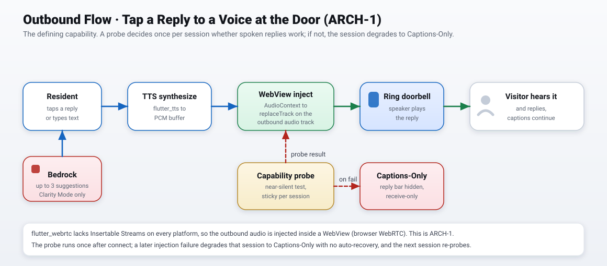

# Threshold Architecture Diagrams

Professional architecture diagrams for Threshold, split into focused views per the
diagram-as-code discipline: one system overview plus three flow diagrams, a shared color
legend across all of them, landscape orientation, and each kept to a small node count so
it reads at a glance. The diagrams are hand-authored SVG (self-contained, no external
icon dependencies), so they render correctly here on GitHub, in a README, and in slides.

## Shared color legend

| Color | Meaning |
|---|---|
| Green | Audio (visitor speech in, spoken reply out) |
| Blue | Control and data (HTTPS, WSS, internal calls) |
| Red | AWS services and hard-failure or degrade paths |
| Amber | Backend and the capability probe |
| Grey (dashed) | Fallback path |

## The views

### 1. System overview
The whole product at a glance: the door, the Flutter app, and the backend + AWS.

### 2. Inbound flow, visitor speech to captions
Two engines: Amazon Transcribe (Clarity Mode, default) and on-device Whisper (Privacy Mode).
Shows how partial versus finalized results drive caption styling.

### 3. Outbound flow, tap a reply to a voice at the door (ARCH-1)
The defining capability. Shows the WebView audio injection path, the capability probe, and
the Captions-Only degrade.

### 4. Event flow, someone at the door to a haptic alert
The idempotent webhook path, the push, the haptic and visual alert, and the poll fallback.

## Notes

- These diagrams model what is actually built and merged (31 tasks, the design system, the
  ARCH-1 WebView approach). They are reconciled against
  `.kiro/specs/threshold-doorbell/design.md`.
- SVG is the source of truth here (sharp, tiny, selectable text). They are self-contained,
  so they do not depend on any local icon path and render anywhere.
